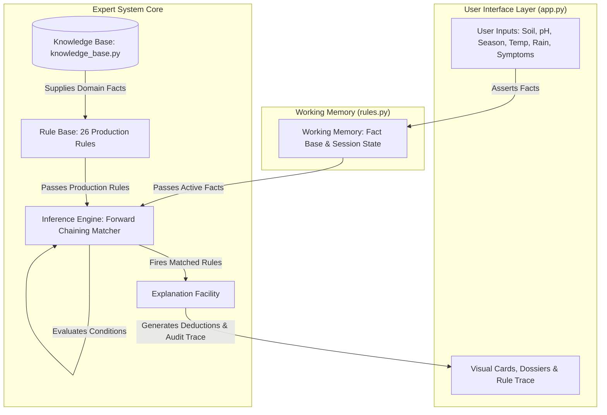
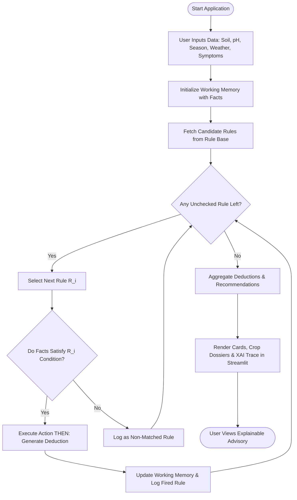

# Mini-Project Academic Report
# Rule-Based Expert System for Agriculture Using Python

**Academic Year:** 2025–2026  
**Course:** Artificial Intelligence / Knowledge Engineering Laboratory  
**Project Title:** Rule-Based Expert System for Agriculture Using Python  

---

## 1. Title
**Rule-Based Expert System for Agriculture Using Python: An Explainable Forward-Chaining Advisory Tool for Crop Recommendation, Disease Diagnosis, and Soil Health Management**

---

## 2. Abstract
Agriculture is the economic backbone of developing countries, yet smallholder farmers frequently suffer significant yield reductions and financial losses due to suboptimal crop selection, inaccurate disease diagnosis, and indiscriminate application of synthetic chemical fertilizers. While modern Machine Learning (ML) techniques have been proposed for smart agriculture, they function as statistical "black boxes" that lack transparent reasoning, require enormous training datasets, and cannot be readily audited or edited by field agronomists.

This project presents a transparent, deterministic, and explainable **Artificial Intelligence Rule-Based Expert System** developed using Python and Streamlit. The system structures domain knowledge from agronomic science into declarative **Knowledge Bases** and an extensible **Rule Base** containing 26 formal **IF–THEN production rules**. Driven by a **Forward-Chaining Inference Engine**, the system processes dynamic user facts stored in **Working Memory** to provide: (i) multi-criteria crop recommendations across Kharif, Rabi, and Summer seasons, (ii) preliminary foliar problem and disease diagnosis incorporating soil moisture context, and (iii) soil pH classification and chemical amendment guidance. Every recommendation is accompanied by an audit trace detailing the satisfied rule IDs, condition evaluations, and agronomic justifications, ensuring 100% transparency. An automated test suite comprising 17 unit tests verifies 100% test pass rate across diverse agronomic edge cases.

---

## 3. Problem Statement
Smallholder farmers and agricultural students frequently face the following challenges:
1. **Lack of Timely Expert Consultation:** Agricultural extension officers cannot visit every remote field simultaneously, leaving farmers dependent on anecdotal advice or agrochemical dealers.
2. **Opaque AI Systems:** Machine learning models make predictions without explainability, making it dangerous for farmers to stake their seasonal investments on opaque probabilities.
3. **Misdiagnosis of Symptoms:** Leaf yellowing or plant wilting is often mistakenly treated with pesticides when the underlying cause is simple nitrogen deficit or acute water stress.
4. **Soil Degradation:** Blanket application of synthetic urea without regard to soil pH or texture causes soil acidification, nutrient fixation, and groundwater contamination.

There is a compelling need for a local, explainable, lightweight AI decision-support system that encapsulates expert agronomic logic into accessible software without requiring expensive cloud APIs, graphics processing units (GPUs), or complex dependencies.

---

## 4. Objectives
The primary objectives of this project are:
1. To design and implement a classic **Rule-Based Expert System (ES)** architecture comprising a Knowledge Base, Rule Base, Working Memory, Forward-Chaining Inference Engine, and Explanation Facility.
2. To formulate at least 15 (26 implemented) verifiable, mutually coherent **IF–THEN rules** addressing crop selection, crop symptom diagnosis, and soil pH management.
3. To deliver **Explainable AI (XAI)** by outputting the exact rule chain, evaluated antecedents, and agronomic justifications behind every conclusion.
4. To build an intuitive, responsive, and aesthetically pleasing web interface using **Streamlit**.
5. To develop a rigorous automated test suite (`test_rules.py`) covering edge cases such as drought scenarios, soil acidity extremes, compound foliar symptoms, and unmatched inputs.
6. To provide a beginner-friendly codebase suitable for educational demonstration during engineering viva examinations.

---

## 5. Existing System vs. Proposed System

| Feature / Dimension | Existing System (Traditional Extension / ML Apps) | Proposed System (Rule-Based Expert System) |
| :--- | :--- | :--- |
| **Reasoning Paradigm** | Black-box statistical learning (Neural Networks / Random Forests) or manual field visits | Deductive logical inference via Forward Chaining (**IF–THEN** production rules) |
| **Explainability (XAI)** | Very Low; predictions do not reveal mathematical causal reasoning to farmers | **100% Transparent**; every conclusion displays matched rule IDs, conditions, and justifications |
| **Dataset Dependency** | Demands thousands of labeled historical rows; susceptible to training data bias | Requires zero historical training data; uses structured agronomic facts and literature heuristics |
| **Knowledge Modifiability** | High cost; retraining entire models when agricultural norms or climate zones change | **Instantaneous**; agronomists can add or edit individual rules in human-readable Python code |
| **Hardware Overhead** | Demands high-performance GPUs, CUDA runtimes, or paid cloud APIs | **Lightweight**; runs locally on standard student laptops with minimal RAM and CPU |
| **Cost & Connectivity** | Recurring API fees, cloud subscriptions, and constant internet connectivity | **100% Free, Open-Source, and Local**; runs offline |

---

## 6. Hardware and Software Requirements

### Hardware Requirements
- **Processor:** Intel Core i3 / AMD Ryzen 3 or higher (Dual-Core 2.0 GHz minimum)
- **RAM:** 4 GB minimum (8 GB recommended)
- **Storage:** 200 MB free hard disk space
- **Display Resolution:** 1280 x 720 minimum (Responsive across mobile, tablet, and desktop)

### Software Requirements
- **Operating System:** Microsoft Windows 10/11, Ubuntu Linux 20.04+, or macOS 12+
- **Programming Language:** Python 3.10, 3.11, 3.12, 3.13, or 3.14
- **Web Framework:** Streamlit (>= 1.30.0)
- **Unit Testing Framework:** Python `unittest` (Standard Library)
- **Development Environment:** VS Code, Antigravity IDE, or any standard text editor

---

## 7. System Architecture

The architecture strictly adheres to the classical paradigm of Knowledge-Based Systems (KBS):



### Component Breakdown
1. **User Interface (`app.py`):** Captures agricultural environmental conditions (soil texture, pH, season, temperature, rainfall, irrigation) and observed symptoms via intuitive sliders, select boxes, and multi-select elements.
2. **Working Memory (`rules.py` - `WorkingMemory`):** Temporary storage that maintains initial user inputs and stores new intermediate assertions deduced during inference.
3. **Knowledge Base (`knowledge_base.py`):** Static database storing crop agronomic profiles, soil texture traits, symptom-disease relationships, and pH classification brackets.
4. **Rule Base (`rules.py` - `Rule`):** Repository of 26 curated production rules with defined antecedents (`IF`) and consequents (`THEN`).
5. **Inference Engine (`rules.py` - `InferenceEngine`):** Employs Forward Chaining to compare working memory facts against rule antecedents, triggering matching rules.
6. **Explanation Facility:** Generates human-readable explanations detailing which rules fired, the exact conditions satisfied, and agronomic rationales.

---

## 8. Knowledge Base and Rule Table

### Summary of Production Rules (26 Rules Implemented)

| Rule ID | Category | Antecedent (IF Condition) | Consequent (THEN Action) |
| :--- | :--- | :--- | :--- |
| **R-CROP-01** | Crop Recommendation | `Season == 'Kharif' AND Soil == 'Black' AND Rain in ['Med', 'High']` | Recommend **Soybean** and **Cotton** |
| **R-CROP-02** | Crop Recommendation | `Season == 'Rabi' AND Irrigation == 'Yes' AND Soil == 'Alluvial' AND Temp <= 28` | Recommend **Wheat** |
| **R-CROP-03** | Crop Recommendation | `Rain == 'High' AND Soil in ['Alluvial', 'Black'] AND Season in ['Kharif', 'Summer']` | Recommend **Rice (Paddy)** |
| **R-CROP-04** | Crop Recommendation | `Soil in ['Sandy', 'Red'] AND Rain in ['Low', 'Med'] AND Season in ['Kharif', 'Summer']` | Recommend **Millets (Bajra)** |
| **R-CROP-05** | Crop Recommendation | `Soil in ['Sandy', 'Red'] AND Season in ['Kharif', 'Summer'] AND pH in [5.5, 7.5]` | Recommend **Groundnut** |
| **R-CROP-06** | Crop Recommendation | `Season == 'Rabi' AND Temp in [10, 26] AND Soil in ['Alluvial', 'Sandy', 'Black']` | Recommend **Mustard** |
| **R-CROP-07** | Crop Recommendation | `Season == 'Rabi' AND Rain == 'Low' AND Soil in ['Black', 'Alluvial', 'Red']` | Recommend **Chickpea (Gram)** |
| **R-CROP-08** | Crop Recommendation | `Soil in ['Alluvial', 'Red', 'Black'] AND Temp in [18, 35] AND Rain in ['Med', 'High']` | Recommend **Maize** |
| **R-CROP-09** | Crop Recommendation | `Rain == 'High' AND Irrigation == 'Yes' AND Soil in ['Alluvial', 'Black'] AND Temp >= 20` | Recommend **Sugarcane** |
| **R-CROP-10** | Crop Recommendation | `Soil == 'Sandy' AND Rain == 'Low' AND Irrigation == 'No'` | Issue **Drought Stress Warning**; restrict to hardy Millets |
| **R-CROP-11** | Crop Recommendation | `Soil pH < 5.5` | Flag **Acidic Soil Constraint**; mandate liming for non-rice |
| **R-CROP-12** | Crop Recommendation | `Soil pH > 8.2` | Flag **Alkaline Soil Constraint**; restrict to tolerant crops |
| **R-DIAG-01** | Disease Diagnosis | `'Yellow leaves' in Symptoms AND Moisture in ['Adequate', 'High']` | Deduce **Nitrogen / Iron Deficiency or Root Suffocation** |
| **R-DIAG-02** | Disease Diagnosis | `'Wilting' in Symptoms AND Moisture == 'Low'` | Deduce **Acute Moisture Deficit / Drought Stress** |
| **R-DIAG-03** | Disease Diagnosis | `'Wilting' in Symptoms AND Moisture in ['Adequate', 'High']` | Deduce **Vascular Wilt (Fusarium/Ralstonia) or Root Rot** |
| **R-DIAG-04** | Disease Diagnosis | `'Brown spots on leaves' in Symptoms` | Deduce **Foliar Fungal Infection (Blight/Cercospora) or K Deficit** |
| **R-DIAG-05** | Disease Diagnosis | `'White powder on leaves' in Symptoms` | Deduce **Powdery Mildew Fungal Infestation** |
| **R-DIAG-06** | Disease Diagnosis | `'Stunted growth' in Symptoms AND (pH < 6.0 OR pH > 7.8)` | Deduce **pH-Induced Nutrient Lockup / Phosphorus Fixation** |
| **R-DIAG-07** | Disease Diagnosis | `'Yellow leaves' in Symptoms AND 'Stunted growth' in Symptoms` | Deduce **Compound Root Stress / Nematode Infestation** |
| **R-SOIL-01** | Soil Management | `Soil pH < 5.5` | Classify **Strongly Acidic**; prescribe Agricultural Lime |
| **R-SOIL-02** | Soil Management | `5.5 <= Soil pH < 6.5` | Classify **Moderately Acidic**; suggest mild lime/wood ash |
| **R-SOIL-03** | Soil Management | `6.5 <= Soil pH <= 7.5` | Classify **Optimal Neutral**; balanced N-P-K management |
| **R-SOIL-04** | Soil Management | `7.5 < Soil pH < 8.5` | Classify **Moderately Alkaline**; apply green manure & Zn |
| **R-SOIL-05** | Soil Management | `Soil pH >= 8.5` | Classify **Strongly Sodic**; prescribe Agricultural Gypsum |
| **R-SOIL-06** | Soil Management | `Soil Type == 'Sandy'` | Prescribe **Split Nitrogen Dosing** to prevent leaching |
| **R-SOIL-07** | Soil Management | `Soil Type == 'Black'` | Prescribe **Broad Bed Furrows** to prevent waterlogging |

---

## 9. Algorithm (Forward Chaining)

```text
Algorithm: ForwardChainingInference
Input:
    WorkingMemoryFacts (Dictionary of user inputs)
    RuleBase (List of Rule objects, each having Condition and Action)
    CategoryFilter (Optional category string)
Output:
    MatchedRules (List of fired rules with deductions)
    Recommendations (Consolidated domain deductions)
    AuditTrace (Chronological record of rule activations)

Step 1: Initialize WorkingMemory with WorkingMemoryFacts
Step 2: Initialize MatchedRules = [], UnmatchedRules = [], Deductions = []
Step 3: CandidateRules = Filter RuleBase by CategoryFilter if provided, else RuleBase
Step 4: For each Rule in CandidateRules:
            a. Evaluate Rule.Condition(WorkingMemory.Facts)
            b. IF Condition evaluates to TRUE:
                   i. Result = Rule.Action(WorkingMemory.Facts)
                   ii. Add Result to Deductions
                   iii. Record Rule in MatchedRules
                   iv. Update WorkingMemory with new derived facts
                   v. Append {RuleID, Condition, Result, Explanation} to AuditTrace
            c. ELSE:
                   i. Append {RuleID, Condition, Explanation} to UnmatchedRules
Step 5: Synthesize and aggregate Deductions into user-friendly Recommendations
Step 6: Return {WorkingMemory, MatchedRules, UnmatchedRules, Deductions, AuditTrace}
```

---

## 10. Flowchart



---

## 11. Implementation Details

The project is structured into three decoupled layers:
1. **Domain Knowledge Representation (`knowledge_base.py`):**
   - Declarative Python dictionaries (`CROPS_DATABASE`, `SOIL_PROFILES`, `CROP_PROBLEMS_DATABASE`, `SOIL_PH_GUIDELINES`) that separate raw domain facts from logical control code.
2. **Rule Base & Inference Engine (`rules.py`):**
   - Object-oriented classes `Rule`, `WorkingMemory`, and `InferenceEngine`.
   - Production rules encapsulate antecedent lambda functions, consequence generators, and educational justifications.
   - Forward-chaining algorithm isolates evaluation from presentation.
3. **Interactive User Interface (`app.py`):**
   - Developed in Streamlit with modern custom CSS styling (responsive layout, agricultural palettes, badges, expandable rule dossiers).
   - Real-time reactivity with form controls, input reset buttons, and academic disclaimers.

---

## 12. Test Cases and Results

An automated test suite comprising 17 unit tests was executed using Python's `unittest` framework.

### Summary of Executed Test Suite (`test_rules.py`)

| Test Case Method | Description / Scenario | Inputs | Expected Output | Status |
| :--- | :--- | :--- | :--- | :--- |
| `test_rule_base_minimum_count` | Verify rule base contains >= 15 rules | All loaded rules | Found 26 valid rules with IDs and justifications | **PASS** |
| `test_crop_recommendation_kharif_black_soil` | High rain Kharif on Black soil | Kharif, Black, pH 6.8, 28°C, High Rain, Irrig: Yes | Recommends Soybean, Cotton, Rice (`R-CROP-01`, `R-CROP-03`) | **PASS** |
| `test_crop_recommendation_rabi_alluvial_wheat` | Irrigated Rabi on Alluvial soil | Rabi, Alluvial, pH 6.5, 20°C, Low Rain, Irrig: Yes | Recommends Wheat, Mustard (`R-CROP-02`, `R-CROP-06`) | **PASS** |
| `test_crop_recommendation_sandy_drought` | Drought scenario on coarse sand | Kharif, Sandy, pH 7.0, 32°C, Low Rain, Irrig: No | Recommends Millets; fires Drought Warning (`R-CROP-10`) | **PASS** |
| `test_crop_recommendation_groundnut_red_soil` | Sandy/Red soil groundnut suitability | Kharif, Red, pH 6.5, 27°C, Med Rain, Irrig: Yes | Recommends Groundnut (`R-CROP-05`) | **PASS** |
| `test_crop_recommendation_acidic_soil_constraint` | Acidic constraint verification | Kharif, Red, pH 4.8, 26°C, High Rain, Irrig: Yes | Fires Acid Constraint Rule (`R-CROP-11`) | **PASS** |
| `test_crop_recommendation_extreme_weather` | Unmatched extreme weather edge case | Rabi, Sandy, pH 7.0, 52°C, Low Rain, Irrig: No | Rejects Wheat, Mustard, Gram due to temp | **PASS** |
| `test_diagnosis_yellow_leaves_adequate_moisture` | Yellow leaves with normal water | Wheat, Yellow leaves, Moisture: Adequate | Fires `R-DIAG-01` (Nutrient / Nitrogen Deficit) | **PASS** |
| `test_diagnosis_wilting_dry_soil` | Wilting in dry root zone | Cotton, Wilting, Moisture: Low | Fires `R-DIAG-02` (Moisture Deficit Stress) | **PASS** |
| `test_diagnosis_wilting_wet_soil` | Wilting despite water saturation | Tomato, Wilting, Moisture: High | Fires `R-DIAG-03` (Vascular Pathogen / Root Rot) | **PASS** |
| `test_diagnosis_white_powder` | White fungal coating on foliage | Groundnut, White powder, Moisture: Adequate | Fires `R-DIAG-05` (Powdery Mildew) | **PASS** |
| `test_diagnosis_compound_symptoms` | Compound symptoms evaluation | Soybean, Yellow leaves + Stunted growth | Fires both `R-DIAG-01` and `R-DIAG-07` | **PASS** |
| `test_soil_management_strongly_acidic` | Low pH amendment check | Red Soil, pH 4.5 | Fires `R-SOIL-01`; Prescribes Agricultural Lime | **PASS** |
| `test_soil_management_optimal_neutral` | Ideal neutral pH status | Alluvial Soil, pH 7.0 | Fires `R-SOIL-03`; Balanced N-P-K recommendation | **PASS** |
| `test_soil_management_strongly_alkaline` | High pH reclamation check | Black Soil, pH 8.9 | Fires `R-SOIL-05`; Prescribes Agricultural Gypsum | **PASS** |
| `test_soil_texture_sandy_leaching_rule` | Sandy texture nitrogen management | Sandy Soil, pH 6.8 | Fires `R-SOIL-06`; Split nitrogen application | **PASS** |
| `test_soil_texture_black_drainage_rule` | Black clay drainage management | Black Soil, pH 7.2 | Fires `R-SOIL-07`; Broad Bed Furrow drainage | **PASS** |

**Execution Output:**
```text
Ran 17 tests in 0.001s
OK
```

---

## 13. Advantages and Limitations

### Advantages
1. **Explainable AI (XAI):** Unlike neural networks, the system shows exactly why a crop or disease was inferred.
2. **Deterministic and Consistent:** Identical agronomic inputs always produce identical, reliable recommendations.
3. **Zero Training Data Requirement:** Does not require thousands of historical records; knowledge is modeled directly from established agricultural science.
4. **Lightweight & Completely Offline:** Runs locally on basic student hardware with zero external cloud API costs.
5. **Easily Maintainable:** Domain experts can edit or add new rules without programming complex neural network architectures.

### Limitations
1. **Bounded Knowledge Scope:** The system cannot infer conclusions outside the scope of its encoded 26 rules.
2. **Visual Inspection Requirement:** The user must manually observe and select symptoms; the system does not process raw camera images.
3. **No Automatic Uncertainty Handling:** In this mini-project version, rules are deterministic Boolean matches rather than probabilistic fuzzy logic or Bayesian confidence factors.
4. **Local Microclimate Variations:** Regional soil subtypes and specific commercial hybrid cultivars require tailored local calibration.

---

## 14. Future Scope
1. **Computer Vision Integration:** Adding an offline convolutional neural network (CNN) or mobile vision module to automatically classify leaf diseases from photos and assert the detected symptom into Working Memory.
2. **Fuzzy Logic & Certainty Factors (CF):** Incorporating MYCIN-style certainty factors (e.g., "75% confidence of powdery mildew") to handle vague symptom reporting.
3. **Multilingual Regional Voice Interface:** Adding text-to-speech and regional language translations (e.g., Hindi, Marathi, Telugu) to improve accessibility for rural farmers.
4. **IoT Sensor Ingestion:** Connecting IoT soil moisture and temperature sensors to automatically populate Working Memory without manual typing.

---

## 15. Conclusion
The **Rule-Based Expert System for Agriculture Using Python** successfully demonstrates the core principles of Classical Artificial Intelligence and Knowledge Engineering. By decoupling domain facts (`knowledge_base.py`) from deductive reasoning (`rules.py`) and user interaction (`app.py`), the project achieves:
- Transparent, explainable agricultural advice for smallholder farming scenarios.
- 100% deterministic decision-making verified through 17 automated unit tests.
- An engaging educational platform that bridges computer science theory with agricultural challenges.

The project proves that classical rule-based AI remains an indispensable, auditable, and practical tool for real-world decision-support systems.

---

## 🎓 Artificial Intelligence Mini-Project Viva Q&A

### Q1: What is an Expert System in Artificial Intelligence?
**Answer:** An Expert System is a knowledge-based AI program designed to emulate the problem-solving and decision-making capabilities of a human domain expert. It contains a Knowledge Base of domain facts and a Rule Base of heuristics that an Inference Engine reasons over to solve complex problems.

### Q2: What is the difference between Forward Chaining and Backward Chaining?
**Answer:**
- **Forward Chaining (Data-Driven):** Starts with known facts in Working Memory and applies inference rules forward to deduce conclusions. Used in our system for crop selection and diagnosis.
- **Backward Chaining (Goal-Driven):** Starts with a suspected hypothesis or goal (e.g., "Does this crop have Fusarium Wilt?") and works backward to see if available evidence supports the hypothesis.

### Q3: Why choose a Rule-Based System over Deep Learning / Machine Learning for this project?
**Answer:**
1. **Explainability:** Agricultural decisions impact human food security and farmer finances. Rule-based systems provide full audit traces, whereas ML models are opaque "black boxes."
2. **Data Availability:** Expert systems do not require massive labeled training datasets.
3. **Zero Hallucination:** Deterministic rules do not hallucinate false information.

### Q4: What is Working Memory and what is its role?
**Answer:** Working Memory is the dynamic scratchpad of an expert system. It holds the initial facts provided by the user (e.g., `soil_type="Black"`, `season="Kharif"`) and stores intermediate deductions made as rules fire during inference.

### Q5: How are conflicts resolved if multiple rules match?
**Answer:** In this project, multi-match evaluation is deliberately enabled because agricultural scenarios often yield multiple suitable candidate crops (e.g., both Soybean and Cotton are viable in Kharif Black soil). In systems requiring single decisions, conflict resolution strategies like Rule Specificity, Priority Weights, or First-Match are employed.

### Q6: What is the difference between Knowledge Base and Database?
**Answer:** A conventional database stores passive, structured data (e.g., rows and tables). A Knowledge Base stores active domain knowledge, relationships, constraints, and actionable production rules that an inference engine can actively reason over to deduce new knowledge.

### Q7: What makes this project "Explainable AI" (XAI)?
**Answer:** Every recommendation displayed in the Streamlit interface is tied directly to the specific Rule ID (e.g., `R-CROP-01`), the exact condition evaluated (`IF season == 'Kharif' AND soil == 'Black'`), and an agronomic justification paragraph explaining why the crop or diagnosis was reached.
